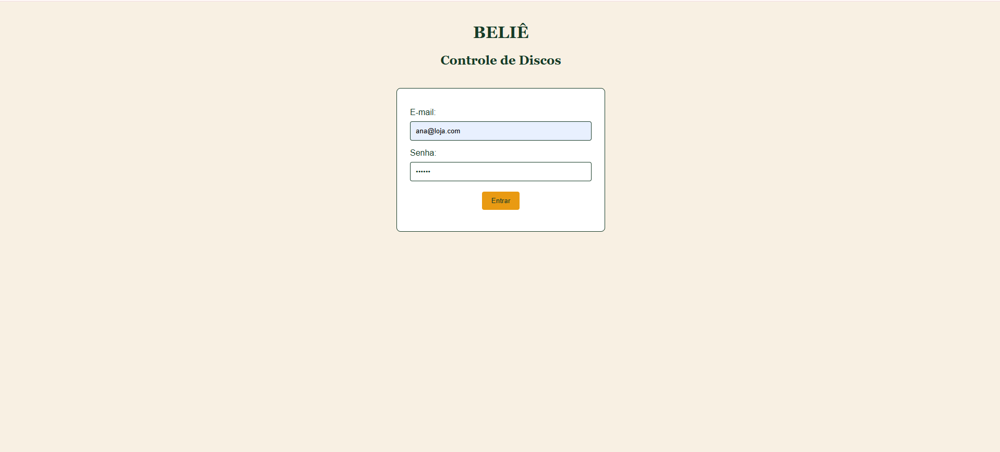
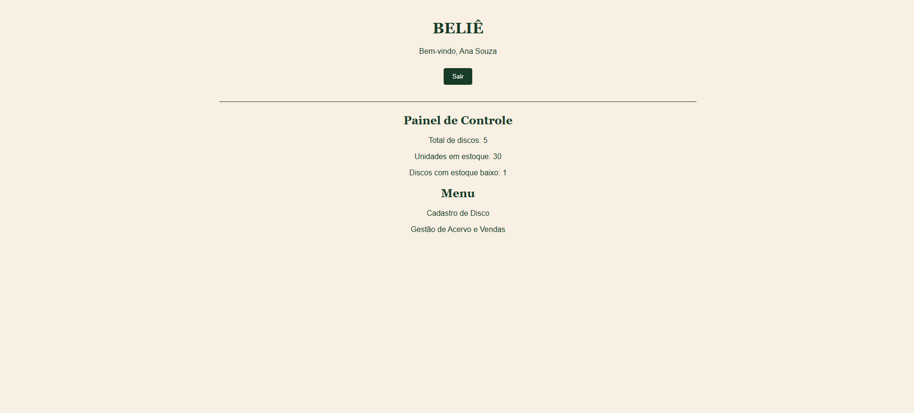
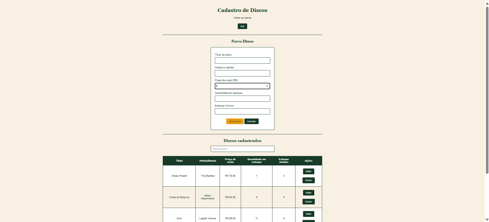
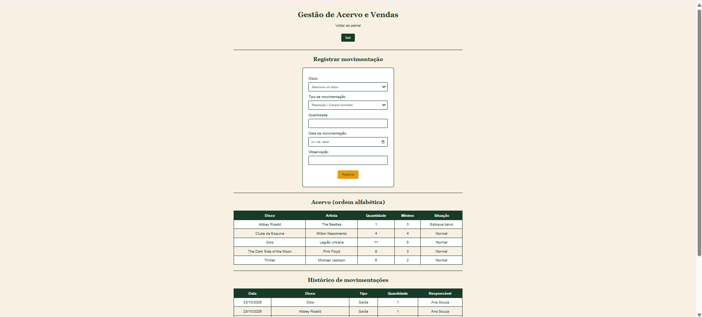

# Loja de Discos – Vinyl Control (Bêlie)

Sistema web para gerenciar discos, estoque e vendas, desenvolvido para o Simulado SAEP do curso Técnico em Desenvolvimento de Sistemas do SENAI, turma 2DES_B.

## Funcionalidades

- Login de usuários.
- Painel com resumo do acervo.
- Cadastro, busca, edição e exclusão de discos.
- Registro de entradas e vendas.
- Histórico de movimentações e alertas de estoque baixo.

## Tecnologias

- HTML, CSS e JavaScript.
- Node.js e Express.
- MySQL e Prisma ORM.

## Estrutura do projeto

- `Backend/`: API e banco de dados.
- `Frontend/`: telas do sistema.
- `Documentos/`: documentação do projeto.
- `prints/`: imagens do sistema.

## Como executar

1. Instale o Node.js e o MySQL.
2. Entre na pasta `Backend` e execute:

   ```bash
   npm install
   ```

3. Configure o arquivo `.env` com os dados do banco de dados.
4. Crie as tabelas e cadastre os dados iniciais
5. Inicie o backend:

   ```bash
   npm run dev
   ```

6. Abra `Frontend/html/index.html` no navegador.

O backend será executado em `http://localhost:3000`.

## Usuários para teste

| Nome | E-mail | Senha |
|---|---|---|
| Ana Souza | ana@loja.com | 123456 |
| Bruno Lima | bruno@loja.com | 123456 |
| Carla Mendes | carla@loja.com | 123456 |

## Documentação

- [Requisitos funcionais](Documentos/Requisitos_Funcionais.md)
- [DER](Documentos/DER.png)
- [Casos de teste](Documentos/Casos_de_teste.md)
- [Requisitos de infraestrutura](Documentos/Requisitos_Infraestrutura.md)

## Prints do sistema

### Login


### Painel principal


### Cadastro de disco


### Gestão de acervo e vendas
